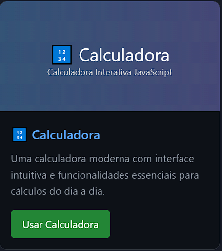

### Olá! 👋 Bem-vindo ao meu Espaço Digital!

  

 

  Sou um entusiasta da tecnologia, apaixonado por desenvolvimento de projetos e segurança da informação. Aqui você encontrará um pouco sobre mim, meus projetos e como podemos nos conectar!

 

  
- 🔭 Atualmente, estou focado em aprimorar minhas habilidades em **Desenvolvimento de Projetos**.
- 🌱 Estou me especializando em **SaaS, MicroSaaS, MCP e Desenvolvimento Android**.
- 🤝 Estou aberto a colaborações em projetos e iniciativas relacionadas à **segurança**.
- 🤔 Busco constantemente aprimorar meus conhecimentos em **tópicos avançados de segurança**.
- 💼 Estou disponível para trabalhos **freelance ou contratos (PJ)**.

 

## Projetos em Destaque

  Confira alguns dos meus projetos mais recentes. Clique para explorar!

<table align="center">
  <tr>
    <td align="center">
      
       
      <a href="https://rogeriomatos75.github.io/Portfolio-Interativo/dino/dino.html">🎮 Dino Game</a> 
      Uma recriação do famoso jogo do dinossauro do Chrome, com mecânicas divertidas e design moderno.
    </td>
    <td align="center">
      
       
      <a href="https://rogeriomatos75.github.io/Portfolio-Interativo/calculadora">🔢 Calculadora</a> 
      Uma calculadora moderna com interface intuitiva e funcionalidades essenciais para cálculos do dia a dia.
    </td>
    <td align="center">
      
       
      <a href="https://rogeriomatos75.github.io/Portfolio-Interativo/lista-de-tarefas">📝 Lista de Tarefas</a> 
      Um organizador de tarefas eficiente para ajudar você a manter suas atividades em ordem.
    </td>
    <td align="center">
      <a href="https://github.com/RogerioMatos75/pandora.git">
        {/* Imagem omitida por enquanto */}
      </a>
       
      <a href="https://github.com/RogerioMatos75/pandora.git">🤖 Pandora API</a> 
      Projeto Pandora - API de IA com Google ADK. API inteligente baseada no Google Agent Development Kit (ADK) que oferece uma interface para interação com um agente de IA personalizado.
    </td>
  </tr>
</table>

 

## Habilidades

  Aqui estão algumas das tecnologias e ferramentas que domino:

  

   
  
  
  
  
  
  
  

 

## Vamos nos Conectar!

  Estou sempre aberto a novas conexões e oportunidades. Sinta-se à vontade para entrar em contato!

  
  
  
  
  
  
  
  
  

 

## Formação e Conhecimentos

  <h4 style="color: #58a6ff; margin-bottom: 15px;">🎓 Formação Acadêmica</h4>
  <ul style="color: #8b949e; list-style-type: none; padding: 0;">
    <li>📚 **Análise e Desenvolvimento de Sistemas** - FIAP (2022 - 2024)</li>
    <li>🔒 **Especialização em Segurança da Informação** - FIAP (2024 - 2025)</li>
  </ul>

  <h4 style="color: #58a6ff; margin: 20px 0 15px 0;">💻 Cursos Técnicos</h4>
  <ul style="color: #8b949e; list-style-type: none; padding: 0;">
    <li>🌐 **Desenvolvimento Web Full Stack** - Trybe (Concluído em 2023)</li>
    <li>📱 **Desenvolvimento Mobile Android** - Udemy (Concluído em 2022)</li>
    <li>☁️ **Cloud Computing e DevOps** - Udemy (Concluído em 2023)</li>
    <li>🔐 **Ethical Hacking e Pentest** - Udemy (Concluído em 2023)</li>
    <li>💻 **Bootcamp Desenvolvimento Full Stack** - DIO (Concluído em 2023)</li>
    <li>💻 **Bootcamp Ciência de Dados** - DIO (Concluído em 2023)</li>
    <li>💻 **Bootcamp Desenvolvimento Android** - DIO (Concluído em 2023)</li>
  </ul>

 

## Certificações e Conquistas

  

    <h4 style="color: #58a6ff; margin: 0 0 10px 0;">🏆 Certificações Microsoft</h4>
    
**MCP** - Microsoft Certified Professional

  

  

    <h4 style="color: #58a6ff; margin: 0 0 10px 0;">🛡️ Certificações de Segurança</h4>
    
**Ethical Hacking Essentials** - Udemy (Concluído em 2023)

  

  

    <h4 style="color: #58a6ff; margin: 0 0 10px 0;">💡 Especializações</h4>
    
**Cloud Computing e DevOps** - Udemy (Concluído em 2023)

    
**Desenvolvimento Mobile Android** - Udemy (Concluído em 2022)

  

  

    <h4 style="color: #58a6ff; margin: 0 0 10px 0;">💡 Bootcamps</h4>
    
**Bootcamp Desenvolvimento Full Stack** - DIO (Concluído em 2023)

    
**Bootcamp Ciência de Dados** - DIO (Concluído em 2023)

    
**Bootcamp Desenvolvimento Android** - DIO (Concluído em 2023)

  

 

  

